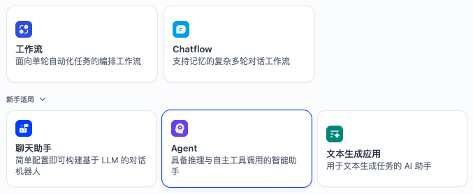

# Dify

开源 LLM 应用开发平台，可视化构建 AI 工作流。

## 核心能力

- **工作流编排** — 可视化拖拽构建 AI 流程
- **RAG 管道** — 知识库管理与检索增强
- **Agent 智能体** — 工具调用与自主推理
- **模型管理** — 接入 OpenAI / 本地模型
- **应用发布** — 一键部署为 API / Web 应用

## 官方资源

- 官网: https://dify.ai
- GitHub: https://github.com/langgenius/dify

# Dify 入门：五种应用类型详解

## 一、五种类型的核心区别

| 类型 | 一句话 | 有无对话记忆 | 复杂编排 | 自主决策 |
|:---|:---|:---:|:---:|:---:|
| **工作流** | 按固定步骤处理，每次独立执行 | ❌ | ✅ | ❌ |
| **Chatflow** | 工作流 + 多轮对话记忆 | ✅ | ✅ | ❌ |
| **聊天助手** | 开箱即用，纯对话无编排 | ✅ | ❌ | ❌ |
| **Agent** | 自主决定调用工具完成任务 | ✅ | ✅ | ✅ |
| **文本生成** | 批量生产文字，不聊天 | ❌ | ❌ | ❌ |

---

## 二、逐个拆解

### 1. 工作流 (Workflow)
像工厂流水线，A → B → C 按序执行，过程透明、结果稳定。

**适用场景：**
- 自动翻译并总结 PDF（提取文字 → 翻译 → 总结）
- 批量处理客户表单，自动分类归档

### 2. Chatflow（⭐ 知识库首选）
工作流 + 多轮对话记忆，记住上下文给出精准回答。

**适用场景：**
- 搭建个人/企业知识库问答
- 需要来回对话的复杂问答场景

### 3. 聊天助手 (Chat Assistant)
Chatflow 青春版，配置极简，绑定模型就能聊，但无复杂编排能力。

**适用场景：**
- 简单 AI 客服、闲聊机器人
- 快速体验，不做复杂逻辑

### 4. Agent
最"聪明"的模式，自主判断需要调用什么工具（搜索、计算器、API、数据库），但可控性低。

**适用场景：**
- 联网查询 + 内部知识库相结合的复杂问答
- 需要多工具协作的任务

### 5. 文本生成
没有对话界面，纯输入指令 → 输出文字的批量工具。

**适用场景：**
- 批量生成商品描述、朋友圈文案

---

## 三、Agent vs 聊天助手 深度对比

| 维度 | 聊天助手 | Agent |
|:---|:---|:---|
| 本质 | 只会动嘴的专家 | 既动嘴又动手的助理 |
| 工具调用 | ❌ 不支持 | ✅ 搜索、代码执行、自定义 API |
| 推理过程 | 直接生成回答 | 先思考(ReAct)、再行动、再回答 |
| 可控性 | 高 | 低，可能绕路或做意外操作 |
| 配置难度 | 极低 | 中等 |
| 成本 | 低（单次 LLM 调用） | 高（多次 LLM 调用） |

**举例：** "查一下今天南京天气，对比昨天，建议穿什么"

- **聊天助手**：训练数据截止后答不出，或胡编 → ❌
- **Agent**：自动调天气 API → 拿数据 → 计算温差 → 给穿衣建议 → ✅

---

## 四、选择建议

| 需求 | 推荐 |
|:---|:---|
| 只回答上传文档里的内容 | 聊天助手 / Chatflow |
| 需要复杂步骤编排 + 对话 | **Chatflow** |
| 需要联网搜索、主动查数据库 | Agent |
| 批量处理文件，无需对话 | 工作流 |
| 批量生产文案 | 文本生成 |

> **新手建议：** 先用 Chatflow 搭知识库跑通流程，熟悉后再升级 Agent 挂载工具。
